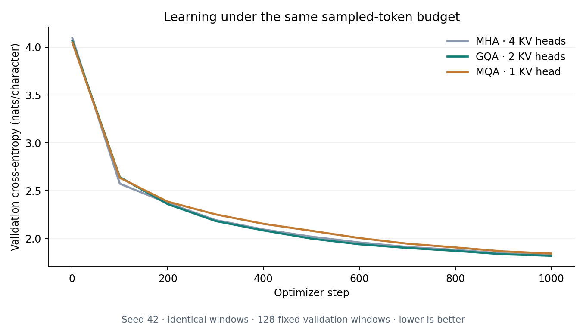
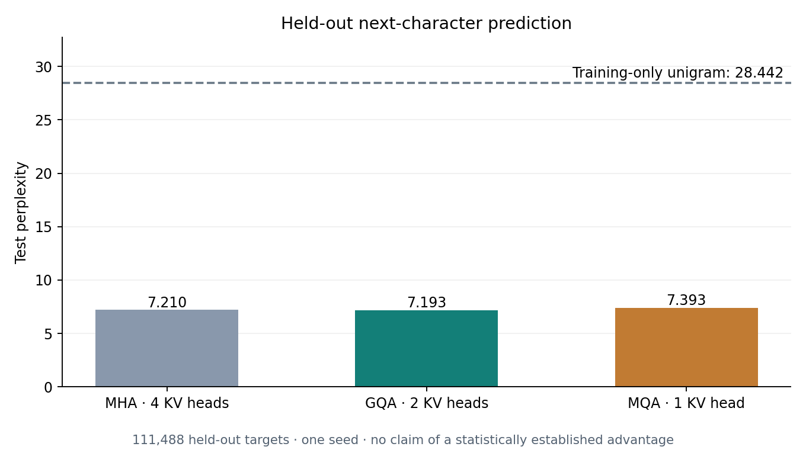
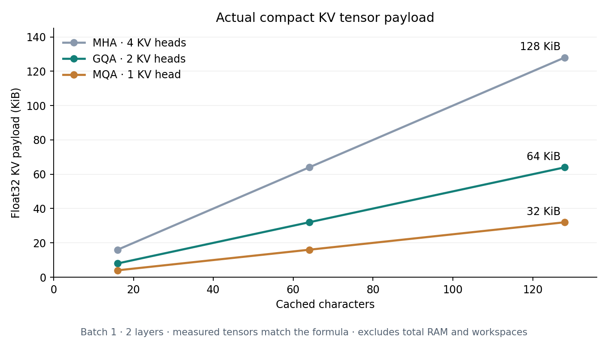
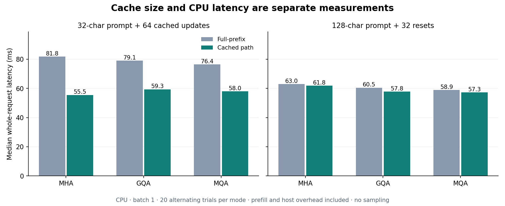
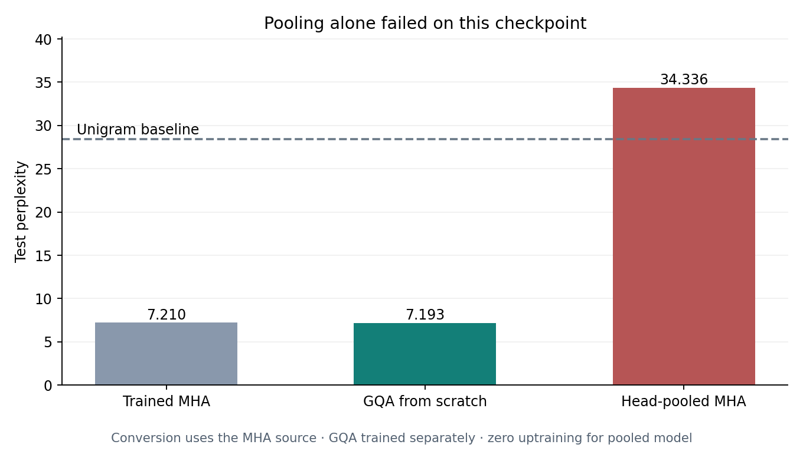
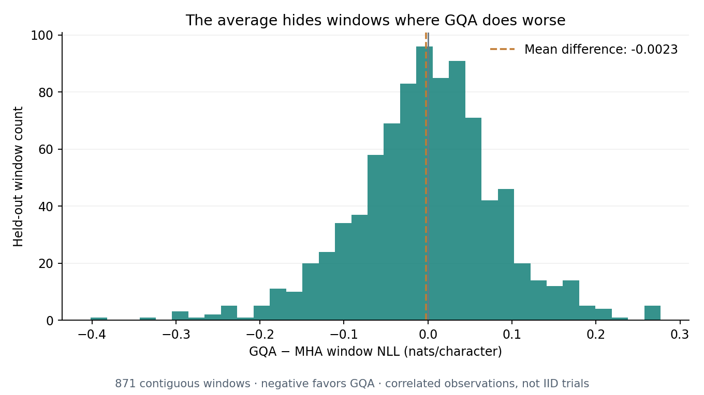

# مشاركة المفاتيح والقيم بين رؤوس الانتباه

دراسة أثر مشاركة عدة رؤوس استعلام في عدد أقل من رؤوس المفاتيح والقيم، باستخدام نموذج محارف مبني من الصفر.

قورنت أربعة رؤوس استعلام مع أربعة أو رأسين أو رأس واحد للمفاتيح والقيم. اختيرت نسخة GQA ذات الرأسين على خسارة التحقق. بلغت حيرة الاختبار 7.1931 مقابل 7.2099 للانتباه القياسي؛ هذا فرق صغير في بذرة واحدة.

تقلصت حمولة موترات التخزين من 128 إلى 64 كيلوبايت عند سياق 128 محرفًا ودفعة واحدة، وإلى 32 كيلوبايت مع الرأس الواحد. هذه أحجام الموترات، لا إجمالي ذاكرة العملية.

رأت النماذج 2,048,000 هدف محرف مأخوذًا بالعينة، خلال 1,000 خطوة وبحجم دفعة 16 وسياق 128 والبذرة 42. لم يُستخدم الاختبار لاختيار البنية أو نقطة الحفظ.

تحويل النموذج القياسي بمتوسط رؤوسه إلى GQA دون تدريب لاحق رفع الحيرة من 7.2099 إلى 34.3360. التحويل محفوظ بوصفه تشخيصًا للفشل، وليس النموذج المختار. لم تكن GQA أسرع من النسخة القياسية المخزّنة مؤقتًا في حمل الاختبار الحالي.

عند تجاوز حد السياق يُعاد تجهيز آخر نافذة كاملة، بدل حذف خانة قديمة فقط؛ لأن الحالات العميقة قد تحتفظ بسياق أقدم.

## النتائج المسجّلة

الأرقام التالية من التنفيذ المحفوظ لهذه النسخة؛ لم تُعَد التجارب أثناء تعريب التوثيق.

### البنية

| النسخة | رؤوس الاستعلام | رؤوس المفاتيح والقيم | ربط رؤوس الاستعلام بالمفاتيح والقيم | شكل موتر التخزين لكل مفتاح أو قيمة |
| :--- | ---: | ---: | :--- | :--- |
| MHA | 4 | 4 | لكل استعلام رأس مفاتيح وقيم مستقل | `[batch, 4, time, 16]` |
| GQA | 4 | 2 | الاستعلامان 0–1 يشتركان في الرأس 0؛ والاستعلامان 2–3 يشتركان في الرأس 1 | `[batch, 2, time, 16]` |
| MQA | 4 | 1 | جميع الاستعلامات تشترك في الرأس 0 | `[batch, 1, time, 16]` |

### اختيار النموذج على التحقق

| النموذج | المعاملات | NLL للتحقق | حيرة التحقق |
| :--- | ---: | ---: | ---: |
| MHA، عدد رؤوس KV: 4 | 86,720 | 1.8602 | 6.4248 |
| **GQA، عدد رؤوس KV: 2** | **78,528** | **1.8519** | **6.3719** |
| MQA، عدد رؤوس KV: 1 | 74,432 | 1.8738 | 6.5132 |

### التقييم النهائي على الاختبار المحفوظ — 111,488 هدفًا من المحارف

| النموذج | NLL بوحدة نات لكل محرف | الحيرة ↓ | دقة المحرف التالي | حمولة المفاتيح والقيم، دفعة 1 وسياق 128 محرفًا |
| :--- | ---: | ---: | ---: | ---: |
| MHA، عدد رؤوس KV: 4 | 1.9755 | 7.2099 | 43.32% | 128 KiB |
| **GQA، عدد رؤوس KV: 2** | **1.9731** | **7.1931** | **43.50%** | **64 KiB** |
| MQA، عدد رؤوس KV: 1 | 2.0005 | 7.3926 | 42.99% | 32 KiB |
| تحويل MHA إلى GQA بدمج الرؤوس دون تدريب لاحق | 3.5362 | 34.3360 | 16.67% | 64 KiB |
| خط أساس أحادي الرموز من التدريب فقط | 3.3479 | 28.4423 | — | — |

### طلب ببادئة متزايدة — 32 محرفًا و64 تحديثًا

| النموذج | وسيط إعادة حساب البادئة | وسيط التخزين المؤقت | المرجع ÷ التخزين المؤقت |
| :--- | ---: | ---: | ---: |
| MHA | 81.85 ms | 55.47 ms | 1.48× |
| GQA | 79.06 ms | 59.34 ms | 1.33× |
| MQA | 76.42 ms | 57.98 ms | 1.32× |

## الرسوم والنتائج المرئية

الرسوم محفوظة من التنفيذ الأصلي. تعريب هذه الصفحة لا يغيّر بياناتها أو تسميات الصور داخل الملفات.

## الملفات المرجعية

- [درجات التنفيذ المحفوظة](runs/metrics.json).
- [بيانات التدقيق وبيئة التنفيذ](audit.json).
- [مرجع البيانات وبصماتها وحدود التقسيم](data/manifest.json).
- [تفاصيل استخدام الأداة](USAGE.md).

## المصادر والإسناد

- [مصدر 1: Pinned Tiny Shakespeare corpus](https://github.com/karpathy/char-rnn/blob/6f9487a6fe5b420b7ca9afb0d7c078e37c1d1b4e/data/tinyshakespeare/input.txt).
- [مصدر 2: GQA: Training Generalized Multi-Query Transformer Models from Multi-Head Checkpoints](https://aclanthology.org/2023.emnlp-main.298/).
- [مصدر 3: RoFormer](https://arxiv.org/abs/2104.09864).
- [مصدر 4: GLU Variants Improve Transformer](https://arxiv.org/abs/2002.05202).
- [مصدر 5: TensorFlow function guide](https://www.tensorflow.org/guide/function).

[المرجع التقني الإنجليزي الكامل](README.en.md) يحفظ تفاصيل النسخة الأصلية. تُترك أسماء الملفات والأوامر ومعرّفات النماذج والمقاييس بصيغتها التقنية لضمان تطابقها مع الكود.
